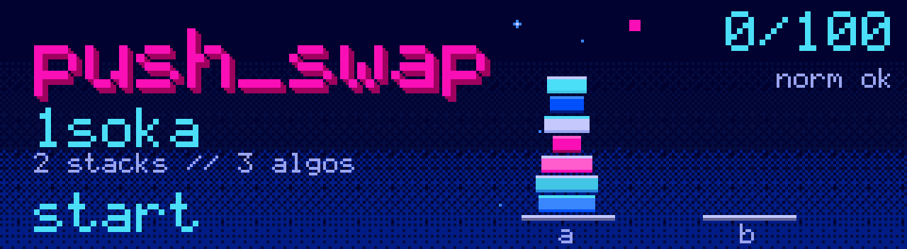

*This project has been created as part of the 42 curriculum by mboulefr, PARTNER_LOGIN.*

<p align="center"></p>

<div align="center">

# 🔀 push_swap — 42 Angoulême


<br>


</div>

## 📖 Description

**push_swap** is a project of the 42 common core. The goal is to sort a list of integers using **two stacks**, `a` and `b`, and a small set of operations (`sa`, `pb`, `ra`, `rrb`…). The program must print the **shortest possible sequence of operations** that sorts stack `a`.

The real challenge is not sorting, it is sorting **with as few moves as possible**. Each strategy in this project is a different trade-off between simplicity and number of operations, so the program can pick the right one depending on how sorted the input already is, measured with a **disorder** score between `0` and `1`.

Every function follows the **Norminette**, and the whole project was checked by **Moulinette** and by peer evaluations.

---

## 📝 Result

<div align="center">
<table>
  <tr>
    <th>push_swap</th>
  </tr>
  <tr>
    <td align="center"></td>
  </tr>
</table>
</div>

---

## ⚙️ Instructions

```bash
make          # build push_swap
make bonus    # build push_swap + checker
make clean    # remove object files
make fclean   # remove object files and binaries
make re       # rebuild everything
```

Run it with a list of integers, the first argument being the top of stack `a`:

```bash
./push_swap 2 1 3 6 5 8
```

Check the result with the checker (bonus):

```bash
ARG="4 67 3 87 23"; ./push_swap $ARG | ./checker $ARG
# OK
```

---

## 🧠 Algorithms

The program embeds four strategies. A flag selects one, and `--adaptive` is the default.

| Flag | Strategy | Time class (in operations) | Idea |
|---|---|:---:|---|
| `--simple` | Selection-style sort | `O(n²)` | Rotate the minimum to the top of `a`, push it to `b`, then push everything back. |
| `--medium` | Chunk sort | `O(n√n)` | Split the values into about `√n` chunks by rank, push each chunk to `b`, then bring back the biggest value first. |
| `--complex` | Radix sort (LSD) | `O(n log n)` | Work on the rank of each number, bit by bit, with `pb` / `ra` and `pa` passes. |
| `--adaptive` | Choose at runtime | depends on disorder | Measure the disorder, then pick a strategy from its regime. |

### Disorder

The disorder is the number of **inverted pairs** (a bigger number before a smaller one), divided by the total number of pairs. It is measured **before any move**:

```
disorder = mistakes / total_pairs      # 0 = sorted, 1 = reversed
```

### Adaptive regimes

| Disorder | Regime | Chosen method | Target |
|---|---|---|---|
| `< 0.2` | Low | Simple | `O(n²)` |
| `0.2 ≤ d < 0.5` | Medium | Medium | `O(n√n)` |
| `≥ 0.5` | High | Complex | `O(n log n)` |

**Why these thresholds?** Below `0.2`, the list is almost sorted, so a simple strategy only needs a few moves and the extra cost of chunking would be wasted. Above `0.5`, the list is close to random, and the `n log n` strategy is the only one that keeps the number of operations under control as `n` grows. Between the two, chunking is a good compromise.

**Complexity argument (upper bounds, in operations):** simple strategy `≈ n²/2` rotations and pushes; medium strategy `≈ n√n` rotations; complex strategy `≈ n log₂ n` pushes and rotations. Space is `O(n)` for the two stacks, plus `O(1)` extra memory for the strategy state.

---

## 📊 Usage and benchmark

```bash
./push_swap --simple 5 4 3 2 1
./push_swap --bench --adaptive $(shuf -i 0-9999 -n 500) 2> bench.txt | wc -l
```

With `--bench`, the program prints on `stderr` the disorder, the strategy used with its complexity class, the total number of operations, and the count of each operation type.

| Input size | Minimum | Good | Excellent |
|---|---:|---:|---:|
| 100 numbers | `< 2000` | `< 1500` | `< 700` |
| 500 numbers | `< 12000` | `< 8000` | `< 5500` |

---

## 📚 Resources

- [Big-O notation](https://en.wikipedia.org/wiki/Big_O_notation): to understand what `O(n²)`, `O(n√n)` and `O(n log n)` really mean.
- [Selection sort](https://en.wikipedia.org/wiki/Selection_sort) and [Insertion sort](https://en.wikipedia.org/wiki/Insertion_sort): the simple family.
- [Radix sort](https://en.wikipedia.org/wiki/Radix_sort): the idea behind the complex strategy.
- [Inversion (discrete mathematics)](https://en.wikipedia.org/wiki/Inversion_(discrete_mathematics)): the basis of the disorder metric.
- `man 3 write`, `man 3 malloc`: references for the allowed external functions.

### How AI was used

AI was used to **explain concepts** (complexity classes, radix sort, inversions), to **review wording** in this README, and to **suggest test cases** for the checker. Every algorithm was **written, tested and explained by us**, and we can defend each part of the code during the evaluation. AI suggestions were always checked against the subject and by peer review.

---

## 🗂️ Repository structure

```
push_swap/
├── Makefile            # NAME, all, clean, fclean, re, bonus
├── push_swap.h         # Prototypes and stack structure
├── push_swap.c         # Parsing and main
├── operations.c        # sa, sb, ss, pa, pb, ra, rb, rr, rra, rrb, rrr
├── disorder.c          # Disorder measurement
├── strategy_simple.c   # --simple
├── strategy_medium.c   # --medium
├── strategy_complex.c  # --complex
├── adaptive.c          # --adaptive
├── bench.c             # --bench output
├── checker_bonus.c     # Bonus checker
└── assets/             # Banner + grade badge used in this README
```

---

## 👥 Contributions

This project was done as a group of two learners.

| Learner | Contribution |
|---|---|
| mboulefr | TODO: parsing, operations, adaptive strategy, README |
| PARTNER_LOGIN | TODO: strategies, disorder metric, checker bonus, benchmark |

---

## 🏆 Final words

A big thank you to everyone at 42 Angoulême who tested our sorts with random lists, reversed lists and lists that were *almost* sorted, and who helped us count operations until the numbers went down. Working as a duo was the best part: we explained our choices to each other, and that made the code much clearer. 💗

Like **Gon** facing **Hisoka** 🃏, push_swap is not about hitting harder: it is about **reading the situation first**, measuring the disorder, and choosing the right move at the right moment. Next project, here we come! 🚀

<div align="center">

**Made with ☕, 💗 and a lot of segfaults by [1soka](https://github.com/1soka)**

</div>
